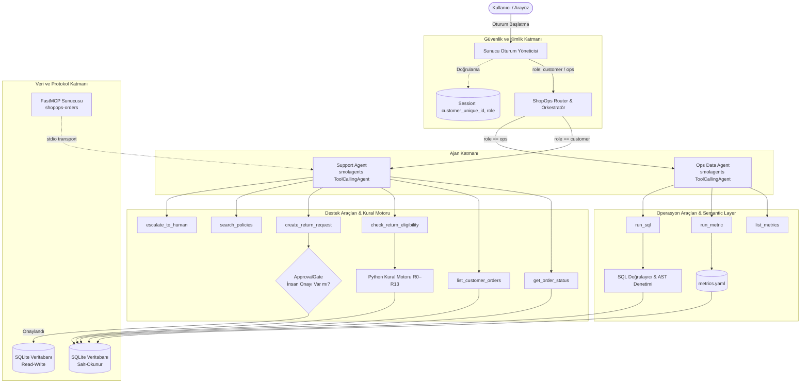

# 🏛️ ShopOps Mimari Belgesi ve Veri Akışı

Bu belge, **ShopOps Pazaryeri Destek ve Operasyon Ajanı** sisteminin mimarisini, bileşenler arası ilişkilerini, güvenlik katmanlarını ve veri akışını detaylandırmaktadır.

---

## 1. Genel Sistem Mimarisi (Mermaid Diyagramı)

---

## 2. Temel Mimari Bileşenler

### 2.1. Orkestratör ve Rol Ayrımı (Router)
- **Güvenlik Prensibi:** Yönlendirme kullanıcının sohbet mesajındaki beyana göre değil, sunucu tarafındaki oturum nesnesine (`Session.role`) göre yapılır.
- Müşteriler (`role="customer"`) sadece müşteri destek ajanına ve ona ait 6 araca erişebilir.
- Operatörler (`role="ops"`) sadece metrik ve analitik araçlarına erişebilir.

### 2.2. Deterministik Kural Motoru (R0–R13)
- İade kararları ve tutar hesaplamaları LLM halüsinasyonundan tamamen izole edilmiştir.
- Süreler `config.SIMULATED_TODAY` (2018-09-01) sabit referans zamanına göre hesaplanır:
  - **R6:** Vazgeçme/geç teslim için 14 gün.
  - **R7:** Hasarlı/yanlış ürün için 30 gün.
  - **R9:** Kargo gecikmesi 10 günden fazla ise navlun iadesi.
  - **R10:** 500 BRL üzeri iadeler `PENDING_SENIOR` onayı gerektirir.

### 2.3. Human-in-the-Loop (HITL) Onay Kapısı
- Veritabanına kalıcı kayıt yazabilen tek aksiyon olan `create_return_request` bir insan onay kapısı (`ApprovalGate`) arkasındadır.
- Ajan talep oluşturduğunda doğrudan kayıt açılmaz; kullanıcıya web arayüzünde onay kartı çıkarılır. Yalnızca insan butona bastığında kayıt commit edilir.

### 2.4. Semantic Layer ve Güvenli SQL
- Operasyon metrikleri `src/knowledge/metrics.yaml` dosyasında önceden test edilmiş standart şablonlar olarak saklanır.
- Serbest sorgularda `validate_sql` fonksiyonu AST ve regex ile `DROP`, `DELETE`, `UPDATE`, `ALTER` gibi yazma aksiyonlarını kesin olarak reddeder; yalnızca salt-okunur `SELECT` sorgularına izin verilir.

---

## 3. Veri Akışı ve Güvenlik Sınırları

1. **Giriş:** Kullanıcı arayüzden mesaj yazar.
2. **Kimlik:** Oturum rolü kontrol edilir; yetkisiz erişim denenirse anında `Erişim reddedildi` döner.
3. **Araç Çağrısı:** `ToolCallingAgent` JSON şemasına uygun tipli araç çağrısı üretir.
4. **Çıkış:** Ham müşteri kimlikleri `pii.py` tarafından maskelenerek (`sha256[:10]`) loglanır ve arayüze aktarılır.

